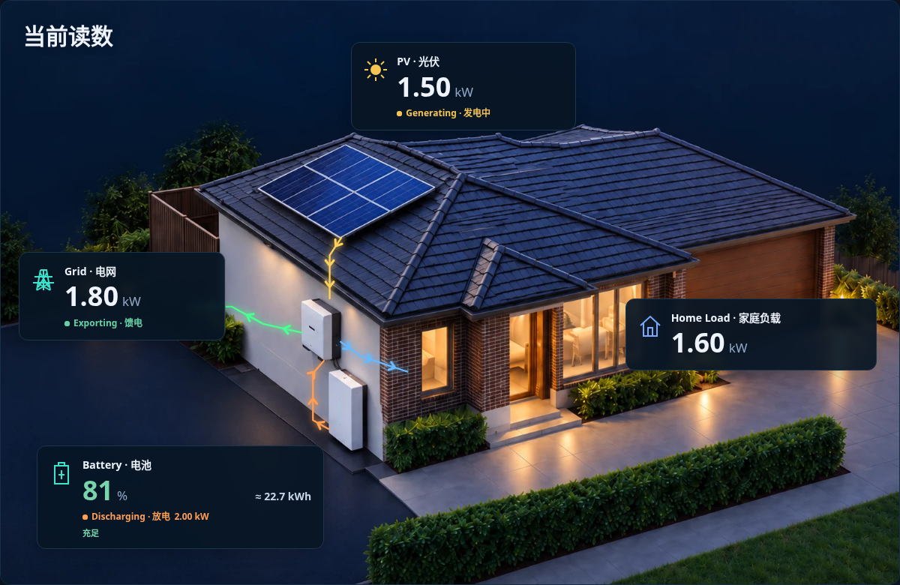
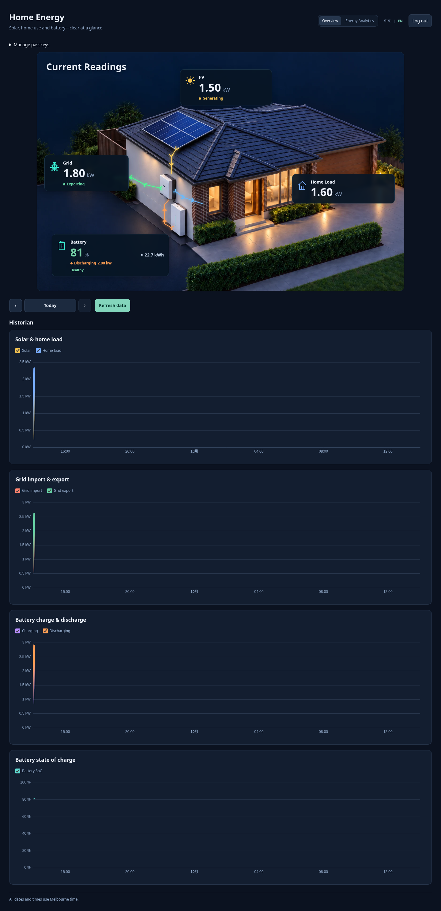
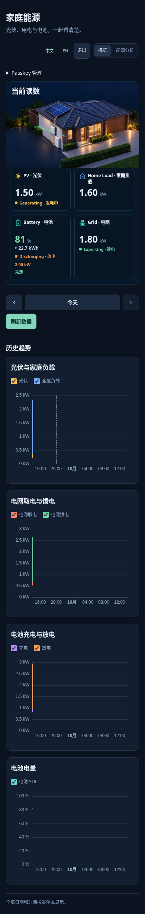
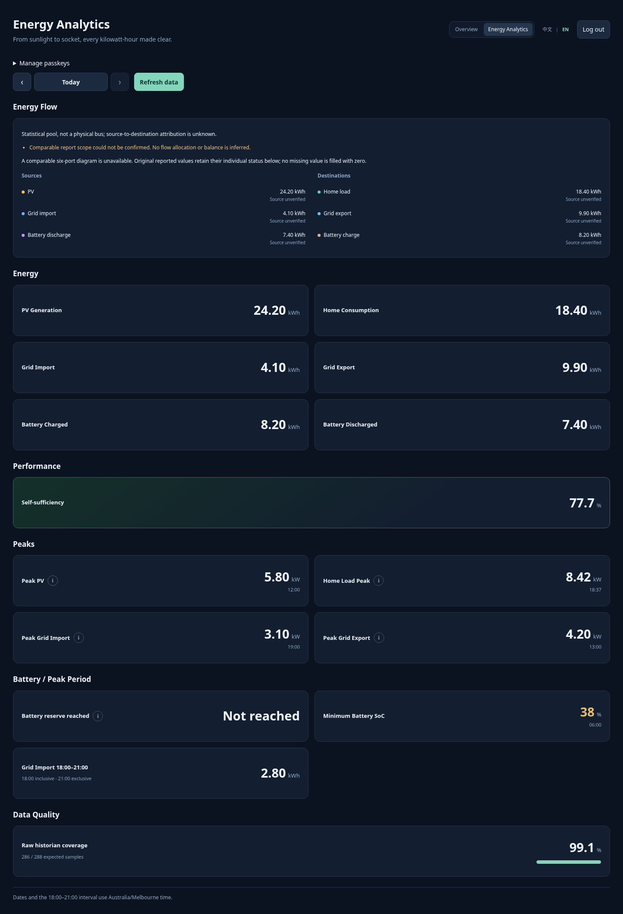
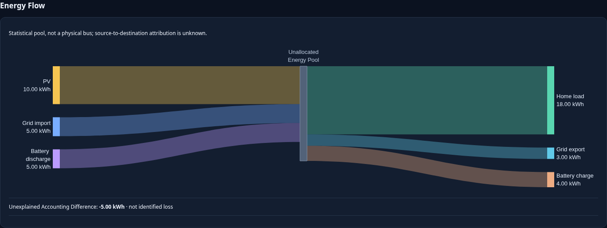
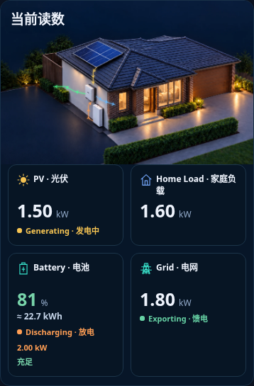
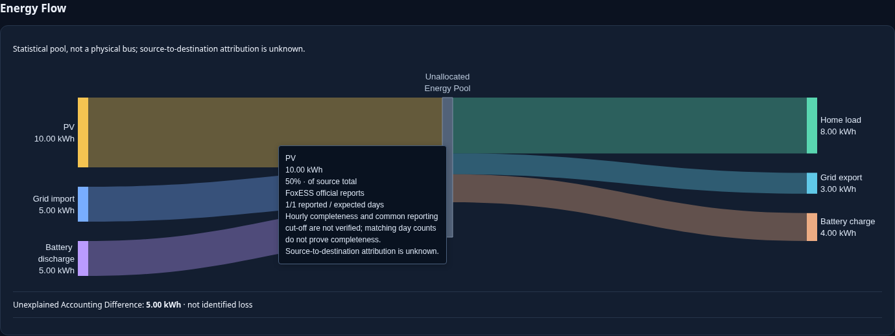
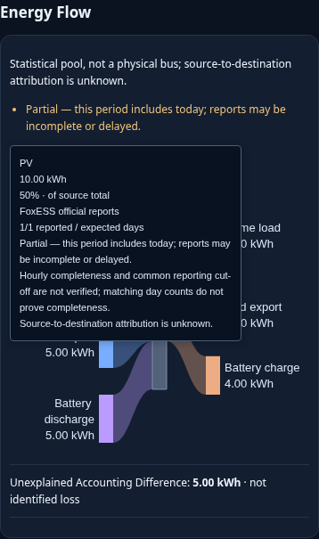
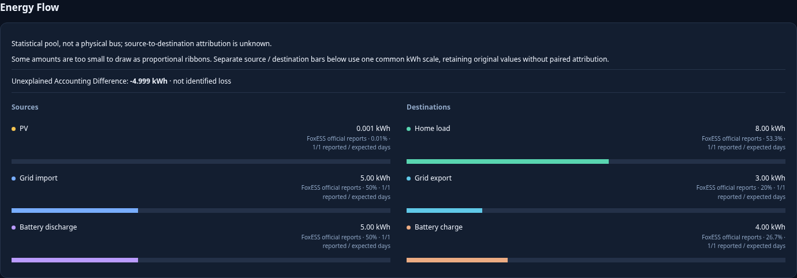

# PR #10 Chromium review screenshots

Original PNG outputs from the v0.6.4 Chromium smoke tests, copied byte-for-byte without editing or regeneration.

- PR: https://github.com/captainboris/home-energy-scada/pull/10
- Reviewed code: `ea68ddff8ef4927008d31cee5712c7e33887292e`
- Captured: 2026-10-21 23:25 Australia/Sydney (2026-10-21 12:25 UTC)
- These are actual browser screenshots with **mock API data**, not production readings or new design renders.
- Desktop and mobile-viewport Chromium evidence; **not** real iPhone Safari/Home Screen verification.
- `daily-desktop.png` uses the existing broad regression fixture, which does not provide all Sankey metadata and therefore shows its unavailable fallback. The separate Sankey screenshots use the complete official-report fixture and demonstrate positive/negative differences, Tooltip and tiny-value fallback.
- This branch contains review artifacts only. It is not a deployment or application source branch and should not be merged into main. Retain it while these links are needed.

## Current Readings Desktop

## Overview Desktop

## Overview Mobile

## Energy Analysis Desktop

## Sankey Desktop — negative accounting difference

## Current Readings Mobile

## Sankey Desktop — positive accounting difference / Tooltip

## Additional browser states

`SHA256SUMS.txt` records each uploaded PNG checksum.
